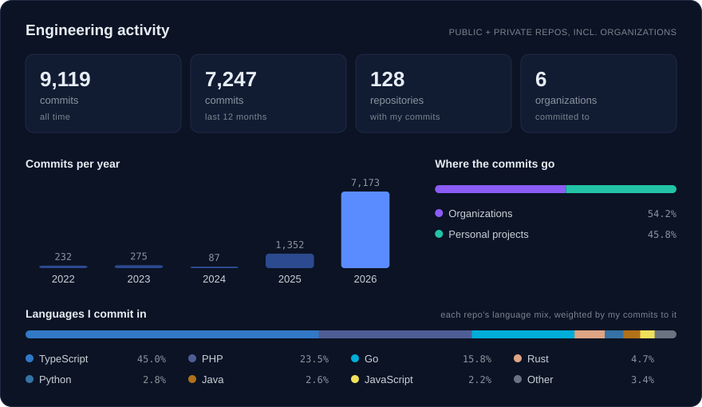

  
  <h1 align="left">Hi, I'm Eduardo 👋</h1>
  <h3 align="left">Backend Software Engineer — Go · Rust · TypeScript · Distributed Systems</h3>

 

Backend engineer focused on APIs, automation and system architecture that hold up under real production load. Currently building internal platforms and AI-assisted automation at **Addebitare** (Brazil). Previously full-stack at **Compass UOL** — AWS Certified Cloud Practitioner.

Core stack: **TypeScript, NestJS, Node.js, Docker, AWS** — deepening into **Go, Rust and Java/Spring** for systems that need heavier concurrency and performance.

---

## 🧸 What I'm building

<a href="https://hypedeveloper.com">
  <picture>
    <source srcset="https://raw.githubusercontent.com/EduardoMG12/EduardoMG12/main/images/mascotes.avif" type="image/avif">
    
  </picture>
</a>

<table>
  <tr>
    <td align="center" width="25%">
      <b>Jato · Talavado</b> 
      Works while you wash.  
      
    </td>
    <td align="center" width="25%">
      <b>Ratão · Mickey</b> 
      One keyboard and mouse for every computer.  
      
    </td>
    <td align="center" width="25%">
      <b>Procyon</b> 
      Security QA for your API, before it ships.  
      
    </td>
    <td align="center" width="25%">
      <b>Sailon · papo</b> 
      The WhatsApp behind my SaaS. Private microservice.  
      
    </td>
  </tr>
</table>

 

## 📌 Featured Projects

- **[mickey](https://github.com/EduardoMG12/mickey)** (Rust · Linux · Windows) — one keyboard, mouse and clipboard shared across every computer on the network: push the cursor off one screen and it lands on the next PC; encrypted and paired by code — [mickey.hypedeveloper.com](https://mickey.hypedeveloper.com)
- **[procyon](https://github.com/EduardoMG12/procyon)** (Go · OpenAPI · CI) — automated security QA for APIs: reads your OpenAPI spec and fails the build when the design leaves a door open (unauthenticated operations, leaked secrets, privilege escalation) — [procyon.hypedeveloper.com](https://procyon.hypedeveloper.com)
- **[papo](https://papo.hypedeveloper.com)** (Go · Postgres · WhatsApp) — private messaging microservice behind my SaaS products (closed source): apps send an intent and papo decides if, when and how to message, with opt-in, number warm-up, rate limits and a Postgres queue with per-chat ordering
- **[payment-gateway-challenge](https://github.com/EduardoMG12/payment-gateway-challenge)** (Rust · Go · React) — distributed payment gateway, exploring systems architecture in the fintech domain
- **[woovi-playground](https://github.com/EduardoMG12/woovi-playground)** (GraphQL · Node.js · MongoDB) — technical challenge for a real job opening at [Woovi](https://woovi.com): accounts, deposits and transaction/ledger logic
- **[kitnet](https://github.com/EduardoMG12/kitnet)** (TypeScript) — full-stack real estate platform connecting owners, brokers and tenants
- **[3dPortfolio](https://github.com/EduardoMG12/3dPortfolio)** (TypeScript · Three.js) — [live demo](https://3d-portfolio-charles-eduardo.vercel.app/)
- **[ia-simpsons-cnn](https://github.com/EduardoMG12/ia-simpsons-cnn)** (Python) — character classification with Convolutional Neural Networks (TensorFlow/Keras)

## 🛠️ Tech Stack & Skills

  <b>Favorites & Focus</b> 
  
  
  

 

  <b>Backend & Frontend</b> 
  
  
  
  
  
  
  
  

 

  <b>Cloud & Tools</b> 
  
  
  
  

## 📊 GitHub Stats

  

---

## 📫 Let's Connect!

  
  
  

 

  
<b>Profile Visitors</b>

  

